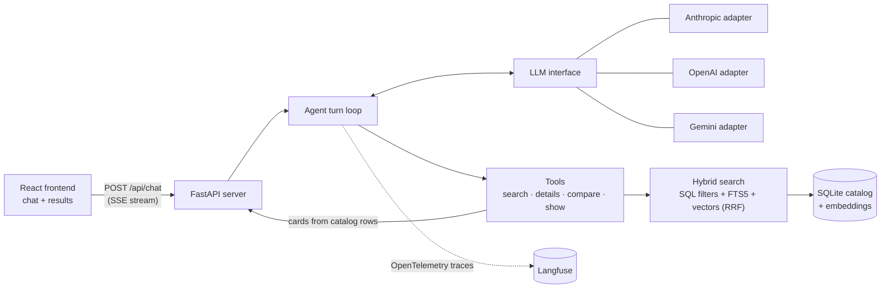

# AI Shopping Assistant

[](https://github.com/kumaranupam-personal/ai_shopping_assistant/actions/workflows/ci.yml)

A conversational shopping agent. Describe what you want in plain English or Hinglish ("garam jacket chahiye, 8k tak"), and the agent searches the catalog, shows matching products as cards, and refines the results as the conversation goes on.

<!-- TODO: add a demo GIF here (the example conversation: Ladakh jacket → "only waterproof" → "compare the first two" → "aur sasta dikhao") -->

```
You:   I'm going trekking in Ladakh in December, need a jacket under 8k, size L.
Agent: [searches jackets ≤ ₹8,000, size L, "warm jacket for high-altitude winter trekking"] → shows 6 cards
You:   only waterproof ones
Agent: [repeats the search with waterproof added] → shows new cards
You:   compare the first two
Agent: [compares the first two products it showed] → summarizes the differences
You:   aur sasta dikhao
Agent: [lowers the budget below the cheapest shown] → new cards, reply in Hinglish
```

## Highlights

- **Provider-agnostic agent.** One tool-calling loop runs on Anthropic, OpenAI or Gemini, chosen by a config variable. Each provider sits behind a small adapter, and only adapters may import a provider SDK (a test enforces this).
- **Grounded by design.** The model picks *which* products to show; product cards are built on the server from catalog rows, never from model text. An eval check flags any price or product the model mentions that no tool returned.
- **Hybrid search.** SQL filters for hard constraints, then SQLite FTS5 keyword ranking and vector similarity, merged with reciprocal rank fusion and capped at 3 products per brand. About 12 ms per search over the 2,400-product demo catalog.
- **Measured, not guessed.** Rule checks for correctness and grounding, and an LLM judge for reply quality that agrees with human labels on 89% of held-out verdicts, on a dev set used for tuning and a holdout set written without seeing the prompt and never tuned on (see [Evaluation](#evaluation)).
- **Traced end to end.** Every turn is an OpenTelemetry trace in Langfuse: one span per model call (tokens, cache reads and writes, cost) and per tool call, grouped by conversation. The code uses only OpenTelemetry, so any OTLP backend works, and message text stays out of traces unless switched on.
- **Robust turns.** Each turn commits or rolls back as a unit: a provider failure, the model-call limit or a client disconnect leaves no half-finished exchange in the session.
- **Hinglish.** Users can write Hindi in Latin script; the agent maps it to catalog terms ("shaadi" → occasion `wedding`, "teen hazaar tak" → `price_max` 3000) and replies in the same language.
- **See how it works.** A static about page at `/saathi/about/` (`http://localhost:5173/saathi/about/` in development) replays one recorded three-turn conversation step by step over an architecture diagram, using the turns' real tool calls and results.
- **Polished, responsive UI.** React 19 + Tailwind v4, streaming over server-sent events, 320 px to 4K layouts, light and dark themes, session restore after reload, and Lighthouse-checked accessibility.

## Architecture



One user message is one **turn**. The loop calls the model, runs the tools it asks for (streaming a status line for each), and ends once `show_products` sends the cards and the reply. The system prompt is static so every provider can cache it, and the conversation history is cached too, so a typical search turn takes 2 model calls. Each turn is exported as a trace whose spans give every model call's tokens, cache use, cost and latency, and every tool call's latency and result.

The agent has four tools:

| Tool | Purpose |
|---|---|
| `search_products` | Filters (category, budget, size, color, brand, rating, attributes) plus a semantic query |
| `get_product_details` | The full record of one product |
| `compare_products` | 2 to 4 products side by side, with the attributes that differ |
| `show_products` | Displays cards with the reply and refinement suggestions; IDs are validated against the catalog |

## Evaluation

`backend/evals/` grades the real agent against the demo catalog in two layers: **rule checks** for whether it did the right thing (the products shown meet the request, every price and product it names came from a tool, it asks or declines when it should, it replies in the user's language), and an **LLM judge** for how good the reply is. Cases come in two sets of 40: a **dev** set used for tuning, and a **holdout** set written by an agent that never saw the prompt, checked to be passable by an agent that follows the spec, and never tuned on. Each holdout run follows a plan committed before it, and only its summaries are looked at. A test fails if any example in the prompt repeats an eval case. Details are in [`backend/evals/README.md`](backend/evals/README.md) and [`docs/07-evaluation.md`](docs/07-evaluation.md).

### Rule checks

Targets: pass rate ≥ 90%, 0 grounding violations, latency p50 < 8 s and p95 < 15 s, and every cacheable call reading from the prompt cache.

| Provider (model) | Dev (40, tuned on) | Holdout (40, never tuned on) | Grounding violations | Holdout latency p50 / p95 | Cost per turn |
|---|---|---|---|---|---|
| Anthropic (`claude-opus-5-5`) | 40/40 | **40/40** in both runs | 0 | 5.7 s / 9.8 s | $0.016 |
| OpenAI (`gpt-6-astra`) | 40/40 | **40/40** in both runs | 0 | 7.6 s / 11.9 s | $0.023 |
| Gemini (`gemini-3.8-flash`) | 40/40 | **40/40** in both runs | 0 | 5.7 s / 20.7 s | $0.006 |

Every pass-rate, grounding and caching target is met on both sets: on Anthropic and OpenAI, every call large enough to cache read from the prompt cache (a 100% hit rate), while Gemini caches on a best-effort basis and isn't checked. Latency varies between runs: Gemini's p95 was 20.7 s in its latest holdout run, and OpenAI's has landed just over 15 s in two runs, so those two miss the p95 target some of the time. A perfect score also means these checks no longer separate a good reply from a great one, which is what the judge is for.

### Reply quality (LLM judge)

An LLM judge (Claude Sonnet 5.5) grades each turn's reply against a 7-criterion rubric drawn from the agent's spec: relevance, helpfulness, faithfulness to the tool results, honesty about relaxed constraints, clarification and decline quality, and language and style. It was calibrated against 60 hand-labeled dev turns, 15 of them deliberately broken copies. **On 20 held-out labeled turns it agreed with the human labels on 89% of verdicts (92% on whether a reply had a problem at all) and caught 4 of 5 broken replies**; its weakest criterion is faithfulness (70%).

| Provider | Turns passing every criterion: dev | Holdout | Weakest criterion on holdout |
|---|---|---|---|
| OpenAI | 85% | **91%** | Helpfulness, 91% |
| Anthropic | 74% | **67%** | Language and style, 72%: replies over 2 sentences, or narrating its own process |
| Gemini | 40% | **54%** | Helpfulness, 61%: replies that restate the cards |

The ranking holds on both sets. Differences of a few points are within the judge's own error; the gaps between providers aren't. Gemini runs the public demo for its low cost, so its reply quality is the clearest gap these results show.

Costs come from each provider's published prices and match the per-call costs Langfuse shows for the same traces. Prompt caching does most of the saving: Anthropic and OpenAI read about 6,800 and 4,300 tokens per turn from the cache, while Gemini's best-effort implicit caching reads almost none. A full 40-case holdout run costs $0.86 on Anthropic, $1.24 on OpenAI and $0.30 on Gemini, and judging one costs about $0.50.

### Public traces

The same eval turn ("I'm going trekking in Ladakh in December, need a jacket under 8k, size L.") on each provider, as public Langfuse traces. Each shows the conversation, both model calls with their tokens, cache use and cost, and the search and display tool calls.

| Provider (model) | Latency | Cost | Trace |
|---|---|---|---|
| Anthropic (`claude-opus-5-5`) | 6.6 s | $0.036 | [View trace](https://cloud.langfuse.com/project/cmus314rs0f4sad0c0vp141i2/traces/75b11d64c0c6d0b97cb8a4ec276318ff?observation=3a5d1a6bdd6852c2&timestamp=2026-10-03T09:02:40.725Z&traceId=75b11d64c0c6d0b97cb8a4ec276318ff) |
| OpenAI (`gpt-6-astra`) | 7.7 s | $0.049 | [View trace](https://cloud.langfuse.com/project/cmus314rs0f4sad0c0vp141i2/traces/1988f5946fb8a08d88a8c14105eebee0?observation=85b55db05a5cc1b0&timestamp=2026-10-03T09:02:49.601Z&traceId=1988f5946fb8a08d88a8c14105eebee0) |
| Gemini (`gemini-3.8-flash`) | 3.5 s | $0.005 | [View trace](https://cloud.langfuse.com/project/cmus314rs0f4sad0c0vp141i2/traces/c6ff1442372c47b11ea4edbbd2f34ed3?observation=94ce0a2ef9e9bac6&timestamp=2026-10-03T09:00:25.010Z&traceId=c6ff1442372c47b11ea4edbbd2f34ed3) |

These are single turns, recorded separately from the full runs above with an earlier prompt version (`137f0d4b5e5b`), so their figures are one sample each.

### How the prompt got here

The first rule-check runs, on an earlier 20-case dev set, scored 17, 19 and 19 of 20 with 5 grounding violations in all. Prompt and tool-description changes only, one per commit and each rerun on all three providers, took them to 20, 20 and 20 of 20 with none: quoting amounts exactly instead of computing or rounding them, and separating filters the user stated from ones the agent inferred, so relaxation drops the inferred ones first and raises the budget by 15% at most once. Those were dev scores, measured on the cases the changes were made for. Two prompt examples turned out to repeat eval cases, so they were replaced and a test now prevents it, and the holdout set and the judge were added to measure the agent on cases it was never tuned on.

## Tech stack

- **Backend:** Python 3.12, FastAPI, Pydantic, SQLite with FTS5, `fastembed` (all-MiniLM-L6-v2, ONNX, no PyTorch), NumPy, managed with `uv`.
- **LLM SDKs:** Anthropic, OpenAI (Responses API) and Google GenAI, each used only inside its adapter.
- **Observability:** OpenTelemetry SDK with the OTLP HTTP exporter, sending to Langfuse Cloud.
- **Frontend:** React 19, TypeScript, Vite, Tailwind CSS v4, `lucide-react`.
- **Testing:** 490 automated tests, none calling an LLM: pytest (390 tests), Playwright (100 tests: layout at 8 widths in both themes on the landing, after a turn, with the drawer and cart open and on the about page, drag-resize, layout shift, session restore, the cart, and every step of the about page's replay with no request outside its origin), Lighthouse for the chat and the about page.

## Quick start

Requires [uv](https://docs.astral.sh/uv/), Node 24 and an API key for at least one provider.

```bash
cd backend
cp .env.example .env          # set LLM_PROVIDER and its LLM_<PROVIDER>_API_KEY
uv sync
uv run python -m demo.generate                          # 2,400 synthetic products
uv run python -m app.catalog.ingest demo/products.jsonl  # build the catalog
uv run python -m app.catalog.embed                      # build the vectors
uv run python -m app                                    # API on :8000
```

Tracing is optional: set `OTEL_EXPORTER_OTLP_ENDPOINT` and `OTEL_EXPORTER_OTLP_HEADERS` in `.env` to send traces to Langfuse or any OTLP backend ([`docs/10-observability.md`](docs/10-observability.md) has the Langfuse values). Without them, tracing is off.

```bash
cd frontend
npm install
npm run dev                   # UI on http://localhost:5173/saathi/
```

Other commands:

| Command | Where | What it does |
|---|---|---|
| `uv run python -m app.cli` | `backend/` | Terminal chat, no frontend needed |
| `uv run pytest` | `backend/` | Backend tests (no API key needed) |
| `uv run python -m evals.run` | `backend/` | Eval suite against the configured provider (makes paid API calls) |
| `npm test` | `frontend/` | Playwright tests against a mocked API |
| `npm run lighthouse` | `frontend/` | Lighthouse on the production build |

## Bring your own catalog

The app serves any catalog that follows the product schema and taxonomy in [`docs/02-catalog.md`](docs/02-catalog.md). Ingestion validates every line, writes rejects with reasons, and swaps the new database in atomically, so a bad file never breaks the running catalog. The demo catalog is synthetic, generated deterministically (seed 42) with no LLM calls.

## Documentation

The full specification lives in [`docs/`](docs/00-overview.md): architecture, catalog, search, agent, API, frontend, evaluation, roadmap, LLM providers, observability, abuse protection, the about page and deployment to EC2 with Docker ([`docs/13-deployment.md`](docs/13-deployment.md)). Each fact lives in exactly one document.

## License

Released under the [MIT License](LICENSE).

Two product icons are copied from other projects under their own licences, each credited in its file: the jacket from Lucide Lab (ISC) and the kurta from Hugeicons (MIT). The fonts, Fraunces and Figtree, are under the SIL Open Font License.
